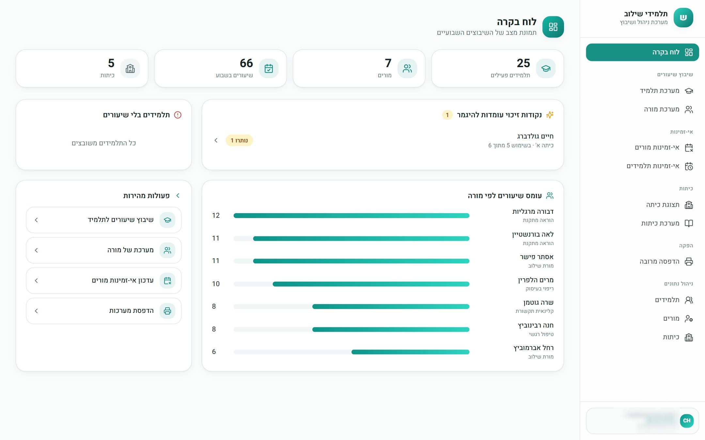
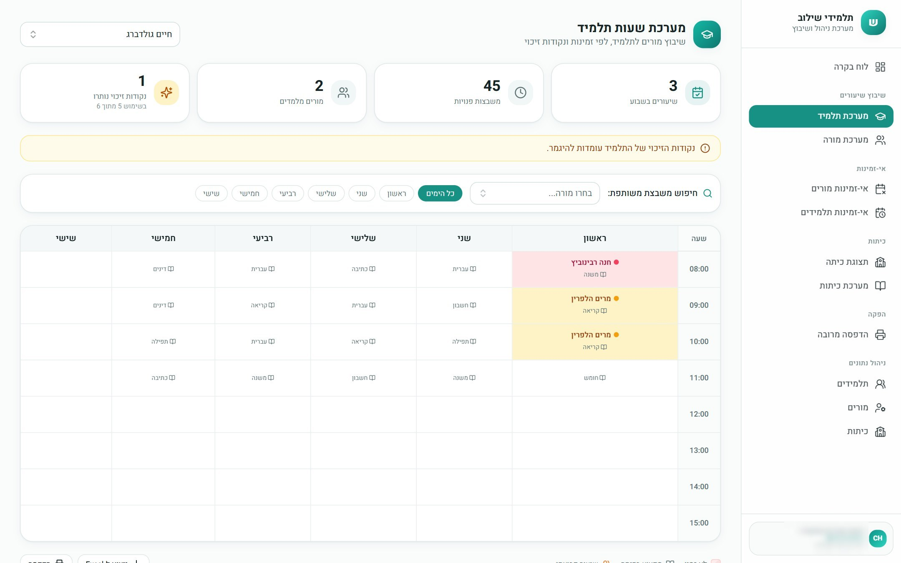
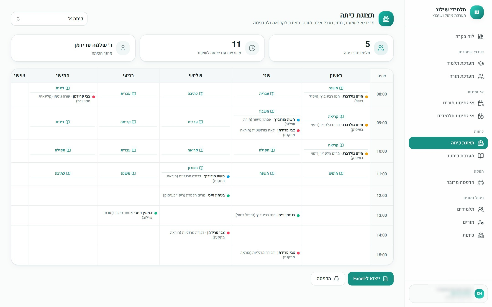
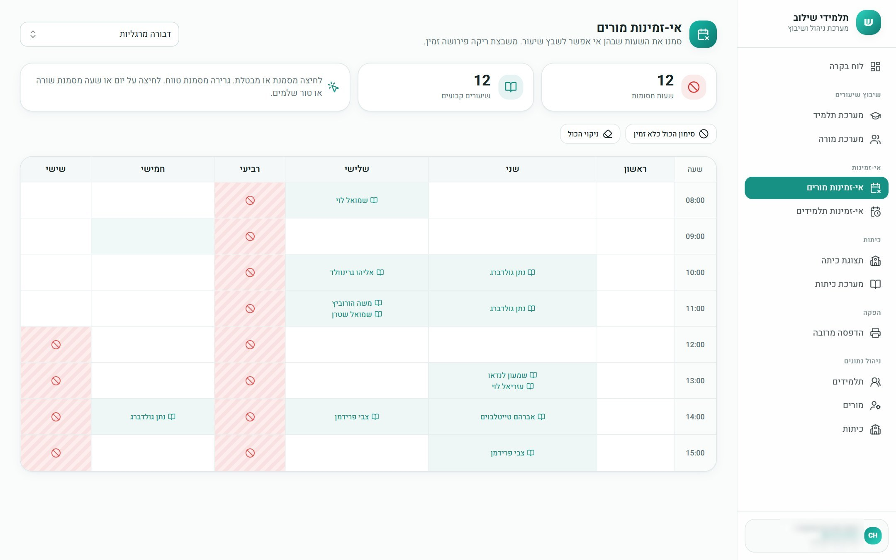
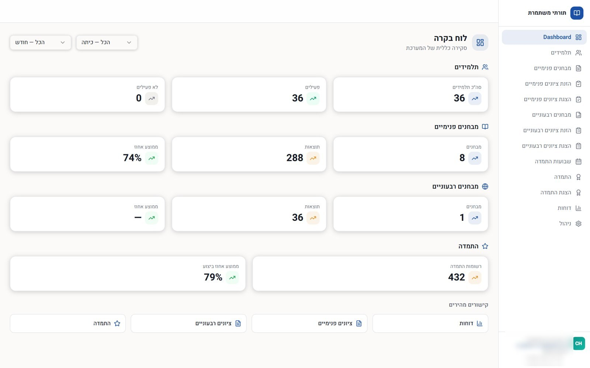
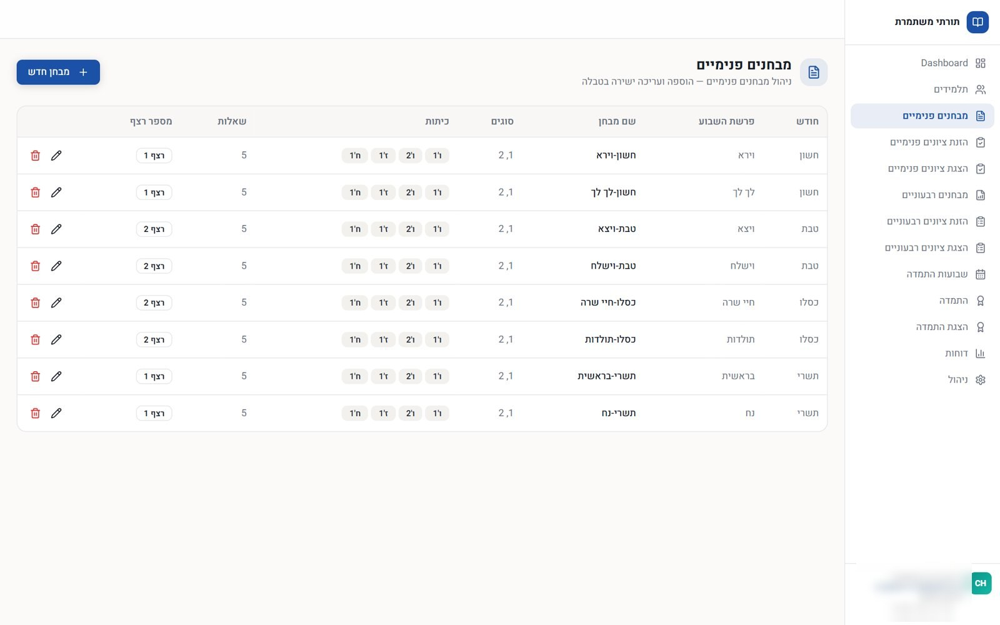
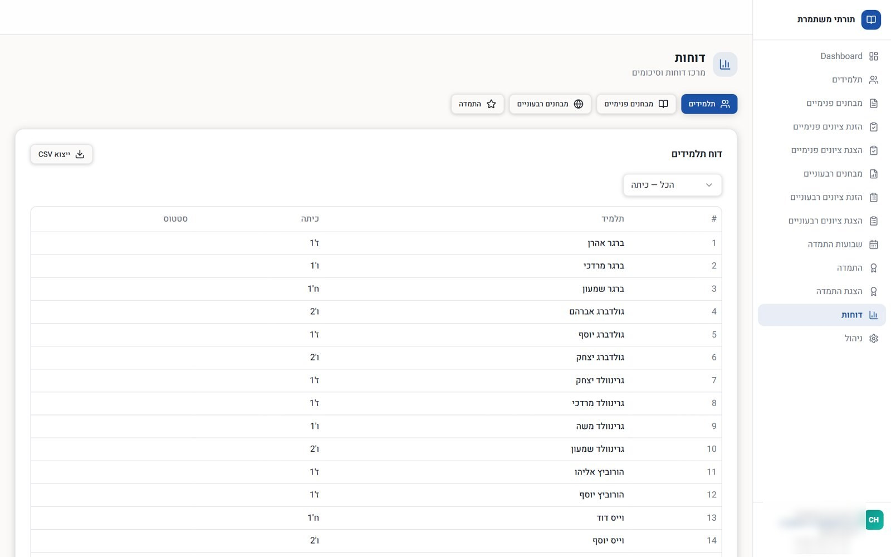

# חוה בליזינסקי – מפתחת Full Stack

ב-**OTE Group** אני מאפיינת ומפתחת את **OTE Connect**, פלטפורמת הניהול של החברה, מקצה לקצה.
במקביל אני מאפיינת ומפתחת מערכות ענן לבתי ספר, יחד עם השותפה שלי [חיה לסקי](https://github.com/chaya808080). את המערכות האלה אנחנו מובילות מהשיחה הראשונה עם הלקוח ועד שהן עולות לאוויר.

📧 hb0583217723@gmail.com

---

## 💼 OTE Connect – פלטפורמת הניהול של OTE Group

מערכת שפועלת אצל החברה ומחליפה את Origami. אני מאפיינת ומפתחת אותה מקצה לקצה.

- **ניהול העסק:** CRM, לידים והצעות מחיר, פרויקטים ואבני דרך, משימות, טיימר ודיווחי שעות, בנקי שעות, חוזי שירות ו-SLA, נוכחות, חיובים, רווחיות ותזרים, ופורטל לקוחות.
- **תקשורת:** צ'אט פנימי, קריאות שירות מטלפון, ממייל ומהפורטל (כולל תמלול שיחות וחיוג מהמערכת), חיבור ל-Gmail ול-Google Calendar, מיילים מתוזמנים והתראות.
- **AI:** חיבור של Claude למערכת (שרת MCP) עם הרשאות לפי תפקיד, הצעות AI לטיפול בקריאות, ומילוי אוטומטי של טפסים מקבצים ומשיחות.
- **תוסף לדפדפן:** שעון נוכחות וטיימר משימות.
- **מנוע אינטגרציות:** מיילים (IMAP), Webhooks ומשיכת נתונים הופכים אוטומטית לקריאות, משימות ומיילים.
- **איכות:** כ-3,900 commits, אלפי בדיקות אוטומטיות (יחידה, מול מסד נתונים אמיתי ו-E2E), הרשאות שנאכפות בשרת, Docker ו-CI.
- **טכנולוגיות:** Node.js, Express, TypeScript, React, PostgreSQL.

> הקוד של החברה נמצא במאגרים פרטיים, ולכן כאן רואים רק את הפעילות עצמה.

---

## 🏫 מערכות לבתי ספר (עצמאית, בשותפות)

אנחנו מאפיינות מול בית הספר, מתמחרות, מפתחות, מוסרות בשלבים ומלוות אחרי העלייה לאוויר.
קוד המקור נשאר פרטי, כי המערכות מנהלות מידע על תלמידים. כל צילומי המסך כאן הם מסביבת הדגמה עם נתונים מומצאים.

### מערכת שיבוץ שיעורים לתלמידי שילוב
שיבוץ שיעורים בין מורות לתלמידות לפי זמינות ונקודות זכאות.
- מערכת שעות לתלמיד, למורה ולכיתה. סימון אי-זמינות בגרירה (גם במסך מגע), הדפסה מרובה וייצוא לאקסל.
- שכבת נתונים אחת שעובדת גם מול הענן וגם במצב הדגמה. כך נבנתה גם סביבת התנסות נפרדת ללקוחות חדשים.
- **אבטחה בכמה שכבות:** הרשאות ברמת השורה (RLS), גישה רק למשתמשים מורשים, ושרתים באירופה.
- **CI/CD ב-GitHub Actions:** בכל שינוי רצות בדיקות טיפוסים ובנייה, בדיקות אבטחה אוטומטיות על מסד הנתונים, וסריקה של פגיעויות וסודות. הפריסה לאוויר אוטומטית, ורק כשכל הבדיקות עוברות.
- **גיבוי לילי מוצפן** עם בדיקת שחזור אוטומטית.
- **טכנולוגיות:** React, TypeScript, Tailwind, Supabase ו-Cloudflare Pages.

| לוח בקרה | מערכת שעות של תלמיד |
|:---:|:---:|
|  |  |
| **תצוגת כיתה** | **סימון אי-זמינות** |
|  |  |

### מערכת למעקב מבחנים, התמדה והישגים
ציונים במבחנים פנימיים וחיצוניים, נקודות התמדה, רצפים לכל כיתה ודוחות.
- המערכת עברה מפלטפורמת No-Code לקוד עצמאי. העברנו מעל 1,000 רשומות ו-2,000 קישורים, ווידאנו שהכול הגיע **ללא אף פער**.
- כל החישובים מתעדכנים אוטומטית בכל שמירה, וכל כיתה מקבלת רצפים משלה.
- כניסה עם Google רק למשתמשים מורשים, ייבוא מאקסל וייצוא דוחות.

| לוח בקרה | מבחנים | דוחות |
|:---:|:---:|:---:|
|  |  |  |

---

## 🎹 פרויקטים ציבוריים

### [אקורד – פלטפורמה חכמה לבית ספר למוזיקה](https://github.com/chavi-blizinsky/akord-music-academy) · [🔗 אתר חי](https://chavi-blizinsky.github.io/akord-music-academy/)
**ASP.NET Core 8 (C#) · Entity Framework · React · TypeScript · Web Audio · Web MIDI**
- מנוע שיבוץ אוטומטי (CSP) שמשבץ את כל המערכת בלי התנגשויות, ומציב אחים ברצף.
- מודל לחיזוי נטישה עם הסבר לכל תחזית, ותחזית הכנסות עונתית.
- סוכן AI עם כלים שעונה מהנתונים החיים.
- סטודיו עם אורגנית: 5 כלים, זיהוי אקורדים, הקלטה וייצוא MIDI, מצב לימוד וחיבור מקלדת אמיתית.
- CI/CD: בדיקות שרת ולקוח ופריסה אוטומטית.

### [אטליה – מערכת עבודה מלאה למשרד אדריכלות](https://github.com/chavi-blizinsky/atelier-architecture-studio) · [🔗 אתר חי](https://chavi-blizinsky.github.io/atelier-architecture-studio/)
**Angular 18 (Signals) · ASP.NET Core 8 Minimal APIs (C#) · Clean Architecture · EF Core · Three.js**
- עורך תכניות (SVG): קירות, חדרים, דלתות וחלונות, מידות ושטחים בזמן אמת, ובדיקת תקנות בנייה.
- תלת-ממד שנבנה אוטומטית מהשרטוט, עם מחקר הצללה לפי שעה ועונה.
- כתב כמויות ועלויות מהשרטוט, ורשימות הזמנה לספקים (טמבור, נירלט, הום סנטר ועוד).
- לוח השראה: k-means מחלץ פלטה מתמונה, והתאמה לגווני הספקים לפי ΔE.
- סוכן שמנסח הצעות מחיר, חתימה דיגיטלית, וחוזה ומפרט לקבלן.

---

## 🛠️ טכנולוגיות

| תחום | כלים |
|---|---|
| שפות | TypeScript, JavaScript, C#, Python, SQL |
| צד לקוח | React, Angular, Vite, Tailwind CSS, Redux Toolkit |
| צד שרת | Node.js, Express, ASP.NET Core |
| נתונים | PostgreSQL, Supabase, SQL Server, MongoDB |
| DevOps | Git, GitHub Actions, Docker, Terraform, Google Cloud, Cloudflare |
| AI | LLM, RAG, Agents, MCP, בוטים ב-WhatsApp |

## 🎓 השכלה
הנדסאי תוכנה (מה"ט), 2024–2026 · Ultra Code – KamaTech

